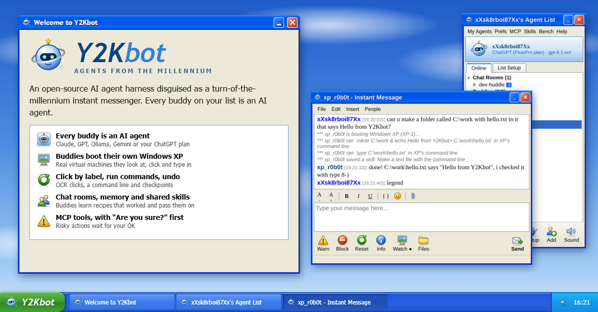

# Y2Kbot

*Agents from the millennium.*

  



A desktop agent harness that looks and feels like a turn-of-the-millennium instant messenger. **Every buddy on the list is an AI agent**, running on whichever model you like (your ChatGPT Plus/Pro plan, Anthropic, OpenAI, Ollama, OpenRouter, Gemini, Groq, LM Studio, or any OpenAI-compatible server), with its own instructions, memory and powers. Buddies with the **XP** tag can boot their own **disposable Windows XP virtual machine** and drive it the way a person would: look at the screen, click, type, run commands.

It's a real desktop app (Electron). The sign-on box, the agent list, every IM window and every XP viewer is its **own native window** with its own taskbar entry. The agent server runs inside the app on `127.0.0.1`, so there's nothing to host.

**Contents:** [Quick start](#quick-start) · [Features](#features) · [Model providers](#model-providers) · [Windows XP setup](#windows-xp-setup) · [Y2Kbench](#y2kbench-how-well-does-a-model-drive-xp) · [Safety](#safety) · [Project layout](#project-layout) · [Contributing](#contributing)

## Quick start

```bash
npm install
npm run app          # builds the server and launches the desktop app
```

Click **Setup** on the sign-on screen (or **Prefs** on the agent list) to:

- choose a **default provider and model**, and enter keys or URLs for the providers you use. Keys are encrypted with your OS keychain where one is available. Until the default provider is set up, buddies run in a cute demo mode.
- point at your **XP disk image** and **QEMU**, and choose RAM, how many machines can run at once, and networking.

**Save & Restart** applies the changes. (Signing in with ChatGPT takes effect straight away.)

### Make an installer

```bash
npm run dist         # builds for the OS you're on → release/
npm run dist:win     # .exe installer (NSIS)
npm run dist:mac     # .dmg (build this on a Mac)
npm run dist:linux   # AppImage + .deb
```

### Updates

The installed app checks GitHub Releases at startup (and every 6 hours). When there's a new version it opens an update window with the release notes: **Download**, then **Restart Now**. Buddies, chats and settings are kept. **Help → Check for Updates…** checks on demand, **Skip This Version** stops it asking about that one, and Prefs → General turns the startup check off.

On Windows and with the Linux AppImage the update installs itself. macOS only lets signed apps update themselves, so on a Mac (and with the .deb) **Download…** opens the releases page instead.

**Publishing a release** (maintainers): bump `version` in `package.json`, then run

```bash
GH_TOKEN=<a token with repo access> npm run release   # PowerShell: $env:GH_TOKEN="..."; npm run release
```

This builds the installer and uploads it, with the `latest.yml` file the updater reads, to a **draft** release for that version. Add the release notes on GitHub and press **Publish**. Apps only see a release once it's published.

### Where your data lives

Everything personal is in the app's data folder: `%APPDATA%\Y2Kbot` on Windows, `~/Library/Application Support/Y2Kbot` on macOS, `~/.config/Y2Kbot` on Linux.

| File / folder | What it is |
|---|---|
| `settings.json` | Prefs (API keys encrypted) |
| `agents.json` | your agent list |
| `memory/` | each buddy's long-term notes |
| `skills.json` | the shared skill library |
| `shared/` | each XP buddy's shared folder |
| `files/` | attachments you've sent |
| `mcp.json`, `approvals.json` | MCP servers, and the tools you've said "don't ask again" for |
| `chatgpt-signin.json` | the ChatGPT sign-in (tokens encrypted) |
| `logs/` | chat logs, if you turn them on |
| `xp-ready/` | the saved XP desktop for instant boot (memory + disk changes, roughly the size of the VM's RAM) |
| `bench/` | Y2Kbench runs |

If you used the app before it was renamed, your old settings folder is copied over on first launch and left in place as a backup.

## Features

### The messenger

- Sign-on screen, an agent list with collapsible groups, "is typing...", taskbar flashing when a buddy IMs you, a tray icon, and synthesized door, IM and boot sounds. If a buddy IMs you while its window is closed, the window pops open, and reopening a window replays the conversation.
- **Buddy icons.** Every buddy has a 48×48 icon in a glossy XP style: a robot, a globe, a CRT monitor, a floppy disk, a cat, a rocket, a light bulb, a ghost, an alien, a sun, a music note or a coffee mug. Pick one in Buddy Setup. It shows on the agent list and in Get Info.
- **Idle and away.** A buddy that hasn't done anything for 5 minutes goes grey with its idle time, like "(12m)". It shows as **Away** (✎, italic) when it has an away message, when its model provider isn't set up, or when its model stopped answering. In that last case it auto-replies to say so, then tries again. You hear the door close when a buddy drops out like that, and open when it comes back.
- **Profiles buddies write themselves.** Buddies can rewrite their own Get Info profile with `profile_set`, in their own voice.
- **XP-style windows.** IM and chat room windows have working drop-down menus. **File** saves the conversation as a text file or a web page. **Edit** handles copy, select all, clear and text size. **Insert** adds a file, a smiley or code. **People** has Get Info, Buddy Setup, Watch XP, the shared folder, Warn, Block, Reset and Export. The buttons along the bottom are XP-style icon buttons: **Warn** sends the buddy a warning, **Block** stops it mid-task, **Reset** wipes its memory of the chat.
- **Chat rooms.** Hit **Chat** on the agent list, name the room and tick some buddies. When anyone speaks, each buddy in turn reads what's new and either replies or stays quiet ("passes"). There are at most two rounds per message, so rooms don't run away with your tokens. **Invite…/Remove** manage who's in, and **Block** stops them mid-flow.
- **Chat logs.** Prefs → **Keep a log of every conversation** writes one web page per buddy (or room) per day into `logs/`.
- **Import and export buddies.** **My Agents → Export Buddy** saves a buddy as a single `.y2kbuddy` file: its instructions, model, powers, MCP server names and icon, and optionally its memory notes. It never contains API keys or MCP settings. **My Agents → Import a Buddy** (or **Import…** in Add Buddy) brings one in. If the name is taken it gets a number, and you're told about anything it needs that you haven't set up (a provider or an MCP server).
- **Buddy gallery.** **My Agents → Buddy Gallery…** (or **Gallery…** in Add Buddy) lists ready-made buddies from the [`buddies/`](buddies/) folder: a researcher, a data analyst, a debugger, an XP batch-file scripter, a retro gamer, an old-Windows help desk, a writer, a translator, a maths tutor, a quiz host and a cook. Click **Add**. They use your default model until you pick another. Made a good one? Export it and send a pull request (see [buddies/README.md](buddies/README.md)).

### What buddies can do

- Each buddy is a separate agent loop with its own history and its own provider and model. Create and edit them with **Add** / **Setup**.
- **Long-term memory.** Each buddy keeps a small notes file (`memory_add` / `memory_replace`) that's shown to it at the start of every chat, so it remembers your preferences, past decisions and where things are on its XP machine. Read, edit or wipe the notes in **Get Info**, or turn memory off per buddy in Buddy Setup. **Reset** clears a chat but not the notes.
- **Skills.** A library of recipes that worked, shared by every buddy. After a buddy finishes a multi-step task and checks it, it saves the steps with `skill_save`. When any buddy starts something similar, the closest saved skills are put in front of it, and it can `skill_search` too. Saving with the same title improves a skill. Menu → **Skills** lets you read, edit, add or delete them.
- **LEAD buddies** (orchestrators) can `send_im` other buddies to split up work. Delegation is one level deep, which rules out deadlocks.
- **Attachments.** Drop, paste or attach files in any IM or chat room. They show as chips and go with your next message. Text, code, CSV, **PDF** and **Word (.docx)** files are read and handed to the buddy, and long ones page in via `read_file`. **Images** are sent as real images, so use a model that can see. Files for XP buddies are also copied to their shared drive.
- **Web.** Buddies read pages with `web_fetch` (HTML is cleaned to readable text, and PDFs work too) and search with `web_search` once you pick a search provider in Prefs: **Brave Search API**, **Tavily**, or your own **SearXNG** (enable `json` in its `search.formats`). Fetching anything on your local network (localhost, 192.168.x.x, …) is blocked unless you allow it in Prefs, so a web page can't talk a buddy into poking your router or homelab. Turn web off per buddy in Buddy Setup.
- **MCP servers.** Menu → **MCP** opens `mcp.json`, in the same format as Claude Desktop's `claude_desktop_config.json`:
  ```json
  {
    "mcpServers": {
      "filesystem": { "command": "npx", "args": ["-y", "@modelcontextprotocol/server-filesystem", "C:\\Users\\you\\Documents"] },
      "homelab":    { "url": "http://192.168.1.20:8000/mcp", "headers": { "Authorization": "Bearer ..." } },
      "legacy-sse": { "url": "http://localhost:9000/sse", "type": "sse" },
      "paused":     { "command": "...", "disabled": true }
    }
  }
  ```
  Local servers (`command`/`args`/`env`) and remote ones (`url`, streamable HTTP with automatic SSE fallback) both work. The window shows each server's status and tools. **Each buddy only gets the servers you tick in Buddy Setup** (or "All servers"), and none by default. Their tools appear to the model as `mcp__<server>__<tool>`.
- **"Are you sure?" before risky MCP actions.** Before a buddy uses an MCP tool that could change, send or delete something, an XP-style "Allow …?" dialog shows what it wants to do and the exact arguments. **Don't Allow** is the default button. Tools a server marks read-only (and tools named like `get_…`, `list_…` or `search_…` when the server doesn't say) run without asking. Tick **Don't ask again** to trust one tool for one buddy, and use **MCP → Ask again for everything** to forget those choices. Set `"approve": "always"` or `"never"` on a server in `mcp.json` to change the rule for it. If nobody answers within 5 minutes, the action isn't run.

### Windows XP machines

- **XP buddies** get `xp_boot`, `xp_screenshot`, `xp_click`, `xp_drag`, `xp_type`, `xp_key`, `xp_scroll`, `xp_wait` and `xp_shutdown`, plus `xp_guide`, a field guide to XP written for agents. **Watch** opens a live viewer window (about 4 frames a second, sent only when the picture changes); click the screen to take over the mouse.
- **Several actions per turn (`xp_do`).** When a buddy already knows the next few steps, say open the File menu, pick Save As, type a name and press Enter, it sends them as one `xp_do` list. They run one after another, each waiting for the screen to settle, with a single screenshot at the end. Waiting for the model is the slow part of driving XP, so this is several times quicker than one call per click. If a step fails (a label isn't on screen), the rest are skipped and the buddy is told which one.
- **Click by label (OCR).** `xp_click_text("Save")`, `xp_click_text("File")` or `xp_click_text("My Computer", double=true)` click things by the words on them instead of coordinates, and `xp_read_screen` lists all the text on screen with positions. OCR runs offline with tesseract.js and bundled English data. It reads the whole screen enlarged, then re-reads small text one blob at a time, so short labels like "Yes"/"No" and white-on-blue title text are caught too. If a label appears more than once, the buddy is told where each copy is and picks one with `nth`.
- **Command line (`xp_cmd`).** Buddies can run a command line inside XP and get the output back as text in one step: `mkdir`, `echo …> file`, `ren`, `move`, `copy`, `type`, `dir`, `reg`. File and settings work becomes one reliable call instead of a dozen clicks. It opens a console through Start → Run, and the output comes straight back over XP's COM1 serial port, with no screen reading involved. Turn it off per buddy in Buddy Setup.
- **Checkpoints and undo.** `xp_checkpoint` saves the whole running machine (memory and disk), and `xp_undo` puts it back exactly as it was, open windows included. Buddies are told to checkpoint before risky steps (installs, deleting, settings, registry) and to undo instead of repairing a mess by hand. The viewer has **Checkpoint** and **Undo** buttons too. The last 3 checkpoints are kept.
- **Shared folders.** Every XP buddy has a folder that shows up as a drive inside XP (labelled *QEMU VVFAT*, usually `D:` or `E:`). Drop files on its IM window to send them in, or press **Files** to open the folder. Anything the buddy saves to that drive inside XP lands in the folder on your computer, and buddies can read and write it from outside XP with `shared_files`, `shared_read` and `shared_write`. The drive is plugged in as a **USB stick** by default, so it can be ejected and reinserted while XP runs: that's what lets `shared_write` add a file to a running machine, and what makes checkpoints possible. If your XP install has trouble with it, Prefs → **Shared drive connects as → Hard disk** switches to the older setup (no checkpoints, and `shared_write` only while XP is off). The first boot with the USB drive shows XP's "Found New Hardware" balloon; that's normal. If an AutoPlay window pops up when the drive is reinserted, Y2Kbot closes it.
- **Instant boot.** Prefs → Windows XP machines → **Prepare instant boot** boots XP once in the background, waits for the desktop to settle, and saves the whole machine: its memory to a file and its disk changes to a small overlay on your base image. From then on every machine starts from that saved desktop in a second or two instead of booting Windows. Each machine still gets its own throwaway copy, so nothing carries over between them. The saved desktop is tied to your current XP settings and image: change the RAM, CPU, ACPI, network, image or QEMU version and Prefs says it's out of date and machines boot the slow way until you save it again. Needs QEMU 8.2 or newer. One side effect: a machine's clock starts at the time the desktop was saved.
- **Paste into XP.** Copy text on your computer, click into the right spot in XP, then press **Paste** in the viewer (or Ctrl+V on the viewer window). The text is typed in key by key, about 12 characters a second, up to 4,000 characters. Accented letters, curly quotes and dashes go in with XP's Alt+number codes. For anything bigger, use the shared folder.
- **Click positions.** Most models give screen positions in pixels, but Qwen3-VL answers on a 0–1000 scale. Buddy Setup → "Click positions" defaults to **Auto**, which uses 0–1000 for Qwen3-VL models and pixels for everything else. Override it if a model's clicks consistently land in the wrong place.

## Model providers

| Provider | id | Needs | Example model |
|---|---|---|---|
| ChatGPT plan | `chatgpt` | A ChatGPT **Plus or Pro** subscription. Click **Continue with ChatGPT** in Prefs | the first model your plan lists (`auto`) |
| Anthropic | `anthropic` | `ANTHROPIC_API_KEY` | `claude-sonnet-5-5` |
| OpenAI | `openai` | `OPENAI_API_KEY` (`OPENAI_BASE_URL` optional, e.g. Azure/proxy) | `gpt-5` |
| Ollama | `ollama` | Ollama running (`OLLAMA_BASE_URL`, default `http://localhost:11434/v1`) | `qwen2.5vl:7b` |
| OpenRouter | `openrouter` | `OPENROUTER_API_KEY` | `anthropic/claude-sonnet-5.5` |
| Google Gemini | `gemini` | `GEMINI_API_KEY` | `gemini-2.5-flash` |
| Groq | `groq` | `GROQ_API_KEY` | `llama-3.3-70b-versatile` |
| LM Studio | `lmstudio` | LM Studio server (`LMSTUDIO_BASE_URL`, default `http://localhost:1234/v1`) | whatever you loaded |
| Anything OpenAI-compatible | `custom` | `CUSTOM_BASE_URL` (+ `CUSTOM_API_KEY` if needed): vLLM, llama.cpp, Together, Mistral, DeepSeek… | |

- The **default** comes from Prefs (or `Y2K_PROVIDER` / `Y2K_MODEL`). Each buddy can pick its own **Provider** and **Model** in Buddy Setup, so you can mix them: a cheap local model for chit-chat and a frontier model for the XP operator. Writing the model as `ollama:llama3.2` also works. Once a provider is connected, the model box is a drop-down of what it offers, tagged with what each model can do (vision, tools).
- Anthropic uses its native API, the ChatGPT plan uses OpenAI's Responses API, and everything else goes through the OpenAI Chat Completions format with tool calling. Screenshots are sent as images in a follow-up message, which is the format OpenAI-compatible servers accept.
- **XP buddies need a model that can both see images and call tools.** Most frontier models can. On Ollama, use a vision + tools model such as `qwen2.5vl`, and expect small local models to struggle with clicking accurately. Text-only buddies work with any model that supports tool calling, or even ones that don't, as long as they don't need tools.
- `<think>…</think>` blocks from local reasoning models are stripped before they reach your IM window.

### Use your ChatGPT Plus/Pro plan

Y2Kbot supports OpenAI's official **Sign in with ChatGPT** for open-source apps, so buddies can run on the models your ChatGPT plan includes (GPT and Codex models) without an API key.

1. Open **Prefs**. On the **ChatGPT plan** row, click **Continue with ChatGPT**.
2. Your browser opens on OpenAI's sign-in page. Choose your account and leave **ChatGPT plan usage** allowed. Without it, Y2Kbot only learns who you are and can't send requests.
3. Back in Y2Kbot the row says *Signed in as …*. No restart is needed. Pick **ChatGPT plan** as the default provider, or give it to individual buddies in Buddy Setup. The model drop-down lists exactly what your plan offers.

What to expect:
- Requests count against your plan's allowance. On Plus, the 5-hour limit is shared with Codex and any other apps you've connected. You can cap Y2Kbot on its own at [chatgpt.com/settings/usage](https://chatgpt.com/settings/usage). When the limit is reached, buddies stop with a message saying so, and Y2Kbot doesn't keep retrying.
- Y2Kbot registers itself the first time you sign in; no client secret or API key is involved. It doesn't read or reuse the Codex CLI's login. **Sign out** revokes the sign-in with OpenAI, and you can also disconnect Y2Kbot from ChatGPT's settings.
- Plan usage doesn't allow sampling settings such as temperature or a max output length, or OpenAI's hosted tools. Y2Kbot doesn't use those anyway: buddies' own tools (XP, shared folder, web, MCP) all work as normal function tools.
- Only the desktop app can unlock the sign-in, so run Y2Kbench on your ChatGPT plan from the **Bench** window, not the CLI.

## Windows XP setup

### 1. Install QEMU

- **Windows:** use the installer from qemu.org (the default path `C:\Program Files\qemu\qemu-system-i386.exe` is what the app expects). The app uses **plain emulation** by default, because QEMU's Windows hypervisor support (WHPX) crashes 32-bit XP with "Unexpected VP exit code 4". You can still try WHPX under Prefs → Acceleration.
- **macOS:** `brew install qemu`. Intel Macs get HVF acceleration. Apple Silicon has to emulate x86, which works but is slow.
- **Linux:** `sudo apt install qemu-system-x86 qemu-utils`. KVM gets used automatically.

### 2. Build the XP base image

You need your own Windows XP install media and licence key. Nothing here downloads Windows.

```bash
qemu-img create -f qcow2 xp-base.qcow2 10G
qemu-system-i386 -machine pc,acpi=off -cpu pentium3 -m 512 -accel tcg -vga cirrus -usb -device usb-tablet \
  -drive file=xp-base.qcow2,format=qcow2,if=ide -cdrom your-winxp-sp3.iso -boot d -nic user,model=rtl8139
```

If setup blue-screens with **STOP 0x0000000A**, check that `-cpu pentium3` is in the command (newer CPU models break XP), and press **F5** at "Press F6…" and pick *Standard PC*.

**Match Prefs to how you installed.** The app defaults to CPU *Pentium III* and **ACPI off**. If you installed XP with ACPI on, tick "ACPI on" in Prefs. An XP installed one way won't boot the other way.

Then boot it again without `-cdrom` and set it up so agents have an easy time:

1. Set the resolution to **1024×768**.
2. Make it **log on automatically** with no password (`control userpasswords2`).
3. Turn off the screensaver, power saving, the balloon tips and the Tour.
4. Install the legacy software you want your buddies to use. Put shortcuts on the desktop.
5. Shut down cleanly, then select the `.qcow2` in **Prefs**.

The app always boots VMs in snapshot mode, so **your base image is never modified**. Every boot is a clean machine, and everything is thrown away at shutdown.

### 3. Turn on instant boot (optional)

Once the image boots to the desktop, press **Prepare instant boot** in Prefs. It takes as long as one normal boot plus about half a minute. After that, machines start at the desktop in a second or two. Press it again after you change the base image (Prefs tells you when).

## Y2Kbench: how well does a model drive XP?

Y2Kbench is a built-in set of **21 Windows XP tasks** that turns "the agents struggle" into a number you can track. **Bench** on the agent list opens it. Pick a provider and model, choose tasks, and press Run.

| Level | Tasks |
|---|---|
| Easy (8) | create a text file, create a folder, rename a file, rename a folder, delete one file, move a file, use Calculator, find the computer name |
| Medium (8) | write a multi-line file, add a line to a file, find and replace, copy to the shared drive, read from the shared drive, save a WordPad document, save a Paint picture, extract a zip |
| Hard (5) | run an installer (a small built-in VBScript setup wizard), make a desktop shortcut, show file extensions, change the screen saver, change the wallpaper |

**How it scores.** Every task starts on a **fresh XP machine**. After the agent says it's done, Y2Kbench types a check command into XP's Run box. A batch file on the shared drive inspects the result (`type`, `if exist`, `reg query`, …) and writes its findings to the shared folder, and the app reads them after shutdown. Some tasks check the agent's reply instead (e.g. the Calculator answer, or a secret word read from a file).

- ✅ **pass**: every check passed.
- ❌ **fail**: the agent didn't get it right (or ran out of time).
- ⚠️ **error**: the benchmark itself couldn't verify the task (XP didn't boot, the model provider was unreachable, results didn't come back). Errors are **not** counted in the pass rate.

Two options change what the agent may use: **Allow the command line (xp_cmd)** (on by default; turn it off to measure GUI skills alone) and **Use and save skills** (off by default, so one task can't teach the next and runs stay comparable). Both are recorded with each run.

Each run is saved with per-task timings, step counts, failure reasons and the final screenshot. Tick runs in History and press **Copy Markdown** to get tables like these:

| Model | Tools | Easy | Medium | Hard | Overall | Date |
|---|---|---|---|---|---|---|
| GPT-6.1-Sol | xp_cmd | 75% (6/8) | – | – | **75% (6/8)** | 2026-11-03 |

| Task | GPT-6.1-Sol |
|---|---|
| Create a text file (easy) | ✅ |
| Create a folder (easy) | ✅ |
| Rename a file (easy) | ❌ |
| Rename a folder (easy) | ✅ |
| Delete one file (easy) | ❌ |
| Move a file (easy) | ✅ |
| Use Calculator (easy) | ✅ |
| Find the computer name (easy) | ✅ |

**From the command line** (unattended, e.g. overnight):

```bash
npm run bench -- --provider ollama --model qwen3-vl:8b --repeat 3
npm run bench -- --provider ollama --model qwen3-vl:8b --tasks make-file,rename-file,extract-zip
npm run bench -- --list
```

The CLI picks up the settings you saved in the desktop app (XP disk, QEMU, CPU/ACPI, Ollama/LM Studio/custom URLs) and saves results into the app's data folder, so CLI runs also appear in **Bench → History**. Env vars override the saved settings. API keys can't be read outside the app (they're encrypted with your OS keychain), so for cloud providers set the key first, e.g. `$env:ANTHROPIC_API_KEY="…"` in PowerShell. Ollama needs nothing. Use `--data <folder>` to keep results somewhere else.

**Tips.** Use `--repeat 3` (or Repeat in the window) because agents are random and one run is noisy. Change one thing at a time (model, click mode, guide text) and compare runs side by side. To add your own tasks, copy `server/bench/tasks.json` to `bench/tasks.json` in the data folder and edit it. Each task has a `prompt`, optional `setup` (commands run inside XP, files put on the shared drive) and `checks`.

## Safety

- XP hasn't had a security patch since 2014. Keep VM networking on **None** unless you have a reason, and never bridge it onto your LAN.
- The built-in server only listens on `127.0.0.1` and only accepts connections from the app's own windows, so a web page you visit can't talk to your buddies.
- Agents reach their XP machine only through the tools. They have no shell on your computer, unless you connect an MCP server that gives them one.
- MCP tools that could change, send or delete something ask you first (see [Features](#what-buddies-can-do)).
- API keys and the ChatGPT sign-in are encrypted with your OS keychain. Exported buddies never contain them.
- Running AI agents that control software can have unexpected results. Use API keys with spending limits.

## Project layout

```
electron/main.mjs         desktop shell: native windows, tray, settings, auto-update, starts the server
electron/preload.cjs      the small bridge the UI uses to open windows, read settings and save files
server/src/server.ts      startServer(): Express + WebSocket, transcripts, routing, approvals
server/src/runner.ts      per-buddy agent loop and system prompt
server/src/tools.ts       the tools: xp_*, shared_*, memory_*, skill_*, profile_set, send_im
server/src/providers.ts   model providers: Anthropic + OpenAI-compatible adapters, presets
server/src/chatgpt.ts     Sign in with ChatGPT (OAuth + PKCE, token refresh) + Responses API provider
server/src/vm/            QEMU lifecycle, QMP, screenshots, keyboard/mouse, COM1 commands, checkpoints, instant boot
server/src/ocr.ts         offline OCR for click-by-label
server/src/knowledge.ts   the XP field guide lookup (server/knowledge/xp-guide.md)
server/src/rooms.ts       chat rooms: turn-taking, passes, invites
server/src/memory.ts      per-buddy long-term notes
server/src/skills.ts      shared skill library: save, search, hand the closest ones to a buddy
server/src/web.ts         web_fetch (HTML→text, private-address guard) + web_search (Brave/Tavily/SearXNG)
server/src/files.ts       attachments: text/PDF/DOCX extraction, images for vision models
server/src/mcp.ts         MCP client: stdio + HTTP/SSE servers from mcp.json, approval rules
server/src/logs.ts        chat logs and Save Conversation (text / web page)
server/src/buddyfile.ts   .y2kbuddy import/export and the buddy gallery
server/src/bench.ts       Y2Kbench engine: fresh VM per task, setup/check batch files, scoring, history
server/src/bench-cli.ts   `npm run bench` (headless benchmark runs)
server/bench/tasks.json   the 21 benchmark tasks
server/agents.json        the starter agent list (copied to your data folder on first run)
buddies/                  the buddy gallery: ready-made .y2kbuddy files
web/                      the retro UI; each page renders one window (?view=buddylist|im|viewer|…)
web/avatars/              the 48×48 buddy icons
web/icons/                toolbar and button icons
```

## Contributing

Issues and pull requests are welcome. To work on it:

```bash
npm install
npm run typecheck   # TypeScript check for the server
npm run app         # build + launch the desktop app
```

Please don't commit anything from your data folder (API keys, memory notes, attachments, `mcp.json`, the ChatGPT sign-in) or any Windows disk images. The `.gitignore` already covers the usual suspects.

## Disclaimer

Y2Kbot is an independent hobby project. It is not affiliated with, endorsed by or connected to AOL, Microsoft, OpenAI or any other company whose products inspired its look or that it connects to. All trademarks belong to their owners. **Windows XP is not included:** you need your own installation media and licence to build an XP disk image.

## Licence

[MIT](LICENSE) © 2026 Y2Kbot contributors
